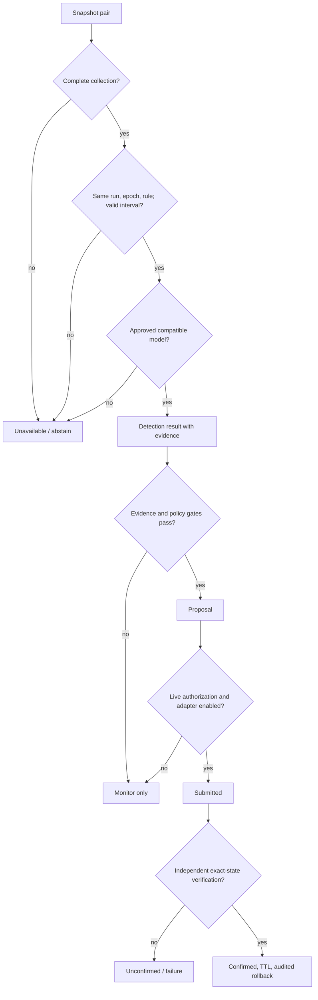

# Architecture

The implementation has two current tracks: the existing research/SDN code and a local synthetic review demo. The demo does not drive the SDN stack.

```mermaid
flowchart LR
  subgraph Live path (implemented components; integration gated)
    MN[Isolated Mininet / OVS] <-->|OpenFlow 1.3 :6653| R[Ryu controller]
    R --> C[Collection and epoch records]
    C --> P[Provenance/completeness audit]
    P --> F[Four rule-counter features]
    F --> D[Live-native detector: UNAVAILABLE]
    D --> X[Evidence/risk/policy contracts]
    X --> A[Mitigation adapter: disabled by default]
    A --> V[Independent OVS verification / rollback]
  end
  subgraph Demo path (runnable)
    B[Loopback JSON API] <--> DB[(SQLite demo store)]
    UI[React TypeScript Vite dashboard] --> B
    B --> S[Synthetic labeled fixtures]
  end
  D -. no approved model .-> B
```

## Boundaries

- Ryu emits OpenFlow rule-stat observations and lifecycle/provenance records. FlowRecord v1 is a rule-stat snapshot, not a bidirectional packet flow and not CICFlowMeter output.
- The live builder consumes complete, same-run, same-epoch snapshots and emits packet delta, byte delta, packet rate, and byte rate only when valid. Missing or ambiguous evidence remains unavailable.
- Offline CICFlowMeter/data-set predictors and the live-native schema are separate contracts. The 77-feature RF cannot be connected to four live features.
- The existing detector, risk policy, and mitigation lifecycle are distinct. Any real enforcement confirmation requires observing the exact expected OVS state; an API receipt is not confirmation.
- The current demo UI connects only to the local API and its own SQLite demo records. It reports controller disconnected, telemetry unavailable, model unavailable, and mitigation disabled.

## Fail-closed paths



## Runtime status

The API remains a standard-library WSGI application with SQLite persistence. The review dashboard is React, TypeScript, and Vite; the replaced static dashboard was removed after API integration. The frontend receives a versioned API base URL from the launcher. A model registry only loads an allowlisted JSON linear model whose manifest and artifact hashes match; historical evaluation JSON remains non-deployable. The optional offline model workflow writes beneath ignored `var/models/`; it never approves that model for live use.
